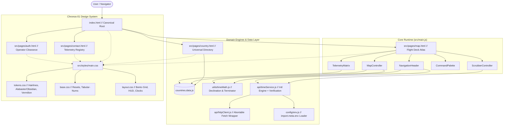

# HOROLOGIUM // Global Temporal & Meridian Telemetry System

> **A tier-1 interactive world timezone atlas, UTC meridian tracker, and live temporal telemetry platform built with Swiss horological precision.**

[](https://vitejs.dev/)
[](https://developer.mozilla.org/en-US/docs/Web/JavaScript/Guide/Modules)
[](https://github.com/shaikimthiyas/On-Map-Time-Zones)
[](LICENSE)

---

## 1. System Overview

**Horologium** (named after the southern celestial constellation *Horologium Oscillatorium* / "The Pendulum Clock") is a high-precision, low-latency temporal telemetry platform. 

Combining the aesthetic discipline of Swiss horology (Braun, Dieter Rams, Patek Philippe world timers) with the functional rigor of aviation flight telemetry and cartographic geodesy:
- **Zero-Latency Client-Side Horology:** Native `Intl.DateTimeFormat` and IANA timezone computation eliminate latency and third-party API rate-limiting.
- **Astronomical Solar Terminator:** Mathematical solar declination and subsolar meridian projection render the real-time day/night shadow boundary directly across equirectangular cartography.
- **24-Hour Mechanical Time Scrubber:** 96-tick radio scale tuner with a 1px Vermilion needle enabling instant simulated time travel across all global meridian bands.
- **Bento Telemetry Matrix:** Docked multi-zone horological cells featuring dynamic 24-hour working hours (09:00–17:00) daylight status ribbons.
- **Geodesic Command Palette (`Cmd+K`):** Substring and fuzzy query search across 220+ sovereign territories and IANA identifiers.

---

## 2. Architectural Blueprint



---

## 3. Directory Structure

```text
horologium/
├── .vscode/
│   ├── settings.json          # Production workspace formatting & linting rules
│   └── extensions.json        # Recommended VS Code extensions
├── public/
│   ├── assets/
│   │   ├── icons/             # SVG telemetry symbology
│   │   └── geo/               # Static TopoJSON / GeoJSON world map vectors
│   └── favicon.svg            # Precision meridian monogram favicon
├── src/
│   ├── api/
│   │   ├── httpClient.js      # Centralized fetch wrapper with timeout & error handling
│   │   └── timeService.js     # Timezone API client with native Intl fallback
│   ├── config/
│   │   ├── env.js             # Validated environment loader (import.meta.env)
│   │   └── constants.js       # App-wide constants, default meridians, intervals
│   ├── data/
│   │   └── countries.data.js  # Modularized 220-nation ISO/IANA geographical database
│   ├── components/
│   │   ├── map/
│   │   │   └── mapController.js    # Interactive SVG world map, graticules, terminator
│   │   ├── clock/
│   │   │   ├── scrubberController.js # 24h mechanical aperture ruler scrubber
│   │   │   └── telemetryMatrix.js    # Docked Bento horology matrix with business hours
│   │   └── ui/
│   │       ├── commandPalette.js     # Cmd+K fuzzy / substring search palette
│   │       └── navigation.js         # Master UTC ticker, solar dec, format & theme toggles
│   ├── pages/
│   │   ├── map.html           # Primary interactive atlas flight deck
│   │   ├── country.html       # Geodesic country & multi-zone breakdown directory
│   │   ├── auth.html          # Operator authentication clearance
│   │   └── contact.html       # Communications & telemetry dispatch registry
│   ├── styles/
│   │   ├── tokens.css         # Design system variables (Hairlines, Colors, Fonts)
│   │   ├── base.css           # Resets, typography rules, tabular-nums enforcement
│   │   ├── layout.css         # Exposed 1px Bento Grid & HUD architecture
│   │   └── main.css           # Master stylesheet importing tokens, base, and layout
│   ├── utils/
│   │   ├── dom.js             # Viewport boundary positioning & DOM helpers
│   │   ├── router.js          # Clean query param routing & navigation helpers
│   │   └── timeMath.js        # Solar declination, subsolar lon, and terminator geometry
│   └── main.js                # Application bootstrap coordinating all subsystems
├── index.html                 # Single Unified Root Entry Point
├── .env                       # Local environment secrets (NEVER COMMITTED)
├── .env.example               # Committed template defining required environment keys
├── .gitignore                 # Production-grade Git ignore rules
├── vite.config.js             # Multi-page Vite build configuration
├── package.json               # Package manifests & lifecycle scripts
└── README.md                  # Executive architectural documentation
```

---

## 4. Environment & Security Hardening

Horologium encapsulates all third-party endpoints and API credentials behind standard Vite environment variables. **No secret keys are bundled in client assets.**

### Environment Configuration (`.env`)

Copy the template file to create your local environment:
```bash
cp .env.example .env
```

Variables defined in `.env`:
```ini
# Application Identity
VITE_APP_NAME="Horologium"
VITE_APP_ENV="development"

# Temporal Telemetry Services
VITE_TIME_API_BASE_URL="https://timezone.abstractapi.com/v1/current_time"
VITE_TIME_API_KEY="your_api_key_here"

# Geodesic & Cartographic APIs
VITE_GEO_API_KEY=""

# Engine Resilience Flags
VITE_ENABLE_FALLBACK_INTL="true"
```

> [!NOTE]
> Even if external time APIs encounter rate limits (e.g., HTTP 429), `src/api/timeService.js` automatically cascades to native browser `Intl.DateTimeFormat` with sub-millisecond precision.

---

## 5. Local Setup & Development

### Prerequisites
- Node.js 18.0+ or Node.js 20.0+ LTS
- npm 9.0+ or pnpm / yarn

### Installation & Execution

```bash
# 1. Clone repository
git clone https://github.com/shaikimthiyas/On-Map-Time-Zones.git horologium
cd horologium

# 2. Install dependencies
npm install

# 3. Start local development server
npm run dev

# 4. Build production bundle
npm run build

# 5. Preview production build locally
npm run preview
```

The application will be accessible at `http://localhost:5173/`.

---

## 6. Design System Specification (Chronos-01)

| Subsystem | Specification |
|---|---|
| **Editorial Typography** | `Instrument Serif` (Italicized accents), `Plus Jakarta Sans` (Legibility UI), `JetBrains Mono` (Tabular Telemetry) |
| **Color Archetype** | **Obsidian Night Deck** (`#080C14` canvas, `#0E131F` surface) / **Warm Alabaster Atlas** (`#F7F6F2` canvas, `#FFFFFF` surface) |
| **Structural Hairlines**| `1px solid var(--border-hairline)` (`#1E2638` in dark mode) without rounded bubble frames |
| **Accents** | Vermilion Indicator (`#FF4D2E`), Radar Green Working Hours (`#10B981`), Amber Warning (`#F59E0B`) |
| **Numerals** | Strict `font-variant-numeric: tabular-nums` preventing layout jitter during live second ticking |

---

## 7. License & Credits

Architected and maintained by **Shaik Imthiyas** and the **Horologium Engineering Group**.  
Distributed under the MIT License.