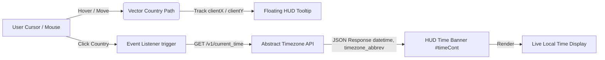

<div align="center">

# 🌍 Global Times — On-Map Time Zones
### *Interactive Vector World Clock & Global Timezone Explorer*

[](https://opensource.org/licenses/MIT)
[](https://github.com/shaikimthiyas/On-Map-Time-Zones/stargazers)
[](https://github.com/shaikimthiyas/On-Map-Time-Zones/network/members)
[](https://github.com/shaikimthiyas/On-Map-Time-Zones/pulls)
[](https://developer.mozilla.org/en-US/docs/Web/JavaScript)
[](https://developer.mozilla.org/en-US/docs/Web/HTML)
[](https://developer.mozilla.org/en-US/docs/Web/CSS)

<p align="center">
  <b>Eliminate timezone confusion with a single click.</b><br>
  Explore the world through an interactive SVG vector map that displays real-time local times and timezone abbreviations for every nation on Earth.
</p>

[Explore Map](#-how-it-works) • [Key Features](#-key-features) • [Quick Start](#-installation--local-setup) • [Architecture](#-system-architecture) • [Contributing](#-contributing)

---

</div>

## 📌 Overview

**Global Times (On-Map Time Zones)** is an intuitive, lightweight, and zero-dependency web application engineered for distributed remote teams, frequent travelers, international researchers, and global communicators.

Navigating disparate time zones often requires juggling conversion tables, manual UTC offsets, or third-party search queries. **Global Times** simplifies this into a tactile geographical experience: simply hover over any region on the vector world map to identify the country, or click it to instantly retrieve and display its live local time, date, and timezone abbreviation via RESTful API integration.

---

## ✨ Key Features

- 🗺️ **High-Precision SVG Vector World Map** — Rendered with scalable vector paths for countries worldwide, ensuring crisp visual fidelity across any display density or zoom level.
- ⚡ **Dynamic Cursor-Tracking HUD** — Real-time mouse tracking calculates pointer coordinates to project smooth, floating country labels directly above target regions.
- 🕒 **Live Atomic Time Synchronization** — Seamlessly connected to the Abstract API Timezone service to deliver accurate local time readings, timestamps, and official timezone codes (e.g., IST, EST, GMT, JST).
- 🎨 **Reactive Visual Feedback** — Interactive hover states illuminate hovered sovereign boundaries with distinctive fill transitions (`silver` highlight upon hover).
- 📋 **Comprehensive Country Directory** — Includes a dedicated tabular timezone reference portal (`country.html`) styled with clean contrast for rapid alphabetical scanning.
- 🚀 **Zero Build Pipeline & Zero Dependencies** — Native Vanilla JavaScript (ES6+), semantic HTML5, and pure CSS. No heavy framework overhead, bundler requirements, or build delays.
- 📱 **Cross-Platform Responsive Layout** — Optimized for desktop displays, tablets, and mobile screens.

---

## 🛠️ Technology Stack

| Layer | Technologies & Tools | Description |
| :--- | :--- | :--- |
| **Core Architecture** | Vanilla JavaScript (ES6+) | Asynchronous fetch requests, DOM manipulation, coordinate math |
| **Markup & Semantics** | HTML5 | Clean document structuring across landing, map, directory, and auth views |
| **Styling & HUD** | CSS3 & Custom Design Tokens | Floating HUD cards, frosted glass overlays, animated hover transitions |
| **Vector Engine** | SVG (Scalable Vector Graphics) | High-resolution geographic path definitions with viewbox coordinate scaling |
| **External API** | Abstract API (Current Time REST API) | Real-time global timezone lookups and atomic datetime resolution |
| **Iconography & Fonts** | FontAwesome 6 & Web Fonts | Crisp UI icons, typography hierarchy, and navigation glyphs |

---

## 🏛️ System Architecture



---

## 📁 Repository Structure

```text
On-Map-Time-Zones/
├── 📄 home.html         # Main dashboard and welcome landing portal
├── 📄 intro.html        # Animated intro splash screen with redirect countdown
├── 📄 map.html          # Core interactive vector world map interface
├── 📄 country.html      # Tabular country timezone catalog and lookup directory
├── 📄 contact.html      # User feedback and inquiry transmission interface
├── 📄 login.html        # Authentication and member sign-in screen
├── 📄 script.js         # Core application logic, event listeners, and API integration
├── 📄 style.css         # Styling system, HUD overlays, tooltips, and map layout
├── 📄 redirect.js       # Auto-redirection router between intro and home page
└── 📄 README.md         # Comprehensive project documentation
```

---

## ⚙️ Installation & Local Setup

Running the project locally takes less than a minute. No `npm install` or package configuration is required!

### 1️⃣ Clone the Repository

```bash
git clone https://github.com/shaikimthiyas/On-Map-Time-Zones.git
cd On-Map-Time-Zones
```

### 2️⃣ Launch the Application

You can launch the application through any of the following methods:

#### Option A: Direct Browser Launch
Double-click `home.html` (or `map.html`) to open directly in Chrome, Firefox, Safari, or Edge.

#### Option B: Python Local Server (Recommended)
```bash
# Python 3.x
python -m http.server 8000
```
Open [http://localhost:8000/home.html](http://localhost:8000/home.html) in your browser.

#### Option C: Node.js / npx serve
```bash
npx serve .
```

#### Option D: VS Code Live Server Extension
Right-click on `home.html` in VS Code and select **"Open with Live Server"**.

---

## 🎮 How It Works

1. **Launch the Map**: Navigate to `map.html` from the home screen.
2. **Inspect Territories**: Move your mouse across the world map. The floating indicator will reveal the country's name as your cursor glides across borders.
3. **Fetch Local Time**: Click on any country. The client fires an asynchronous API request:
   ```javascript
   const api_url = `https://timezone.abstractapi.com/v1/current_time/?api_key=${API_KEY}&location=${countryId}`;
   ```
4. **Read Real-Time Clock**: The floating top banner instantly updates with:
   $$\text{[Country Name]'s time} = \text{YYYY-MM-DD HH:MM:SS} \quad [\text{Timezone Code}]$$

---

## 🔑 API Configuration (Optional)

The application utilizes the **Abstract API Current Time API**. 
If you wish to configure your own free API key for higher rate limits:

1. Sign up for a free key at [Abstract API Timezone](https://www.abstractapi.com/api/timezone-api).
2. Open [script.js](file:///script.js) and update the `api_key` parameter in the `getUser` function:
   ```javascript
   const api_url = `https://timezone.abstractapi.com/v1/current_time/?api_key=YOUR_API_KEY_HERE&location=${place}`;
   ```

---

## 🗺️ Roadmap & Upcoming Enhancements

- [ ] **Autocomplete Search Bar** — Jump directly to and highlight any country via keyboard input.
- [ ] **Browser Native Offline Mode** — Graceful fallback using `Intl.DateTimeFormat` when offline or if API limits are reached.
- [ ] **Solar Day/Night Terminator** — Real-time shadow projection showing day and night halves of the globe.
- [ ] **Favorite Cities Dock** — Pin frequently watched time zones to a persistent quick-access drawer.
- [ ] **Dark / Light Theme Toggle** — System-aware palette switcher for comfortable nighttime navigation.

---

## 🤝 Contributing

Contributions make the open-source community an amazing place to learn, inspire, and create. Any contributions you make are **greatly appreciated**.

1. **Fork the Project** (`Click Fork at top-right`)
2. **Create your Feature Branch**:
   ```bash
   git checkout -b feature/AmazingFeature
   ```
3. **Commit your Changes**:
   ```bash
   git commit -m "feat: add interactive search autocomplete"
   ```
4. **Push to the Branch**:
   ```bash
   git push origin feature/AmazingFeature
   ```
5. **Open a Pull Request** via GitHub.

---

## 📄 License

Distributed under the **MIT License**. See [`LICENSE`](LICENSE) for more details.

---

## 👤 Author & Maintainer

**Shaik Mohamed Imthiyas**
- GitHub: [@shaikimthiyas](https://github.com/shaikimthiyas)
- Project: [On-Map-Time-Zones](https://github.com/shaikimthiyas/On-Map-Time-Zones)

---

<div align="center">
  <sub>Built with ❤️ for global explorers and distributed teams worldwide. If you find this project useful, please consider giving it a ⭐ on GitHub!</sub>
</div>